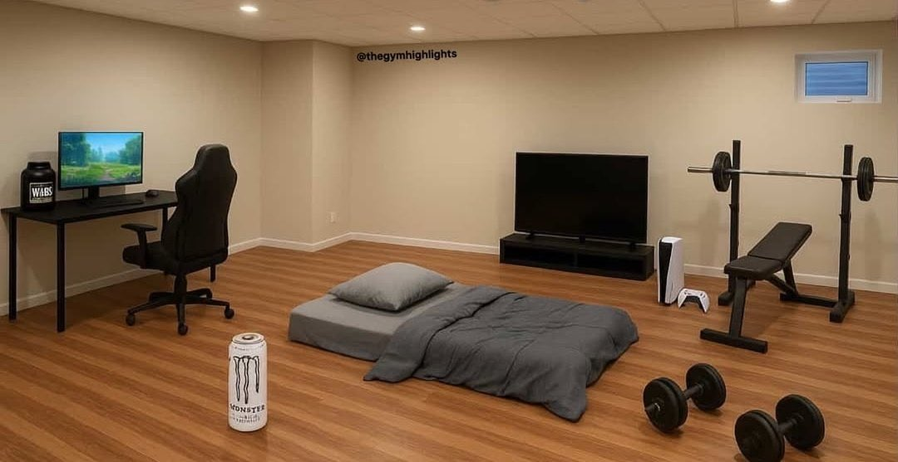

<h1 align="center">薄拉图.skill 🙏</h1>

<blockquote>
<p align="center"><em>薄肌负责升级肉体，薄拉图负责给脑子打补丁。</em></p>
</blockquote>

<p align="center">
  
  
  
  
</p>

<p align="center"><b>邵艾伦（硅基版） · 年轻人的认知升级补丁</b></p>

<p align="center">
想做自媒体，怕熟人看到？<br>
AI 教程收藏了三个月，工作流一点没变？<br>
想换工作、试新方向，又不知道第一步怎么走？
</p>

<p align="center">
薄肌娃儿们，先别在脑子里把人生通关了。<br>
把你手里的牌摆出来：会什么、试过什么、到底卡在哪。<br>
版本答案，也得看你的装备。先聊清楚，再动手。
</p>

<p align="center">
<b>重点蒸馏：邵艾伦 × 孙宇晨《年轻人如何抓住 AI 时代的机会？》</b><br>
完整 4 小时 22 分钟访谈机器转写，加上 1111 条本人公开帖文。
</p>

<p align="center"><sub>非官方模拟思维顾问，原作者未参与或背书。</sub></p>

<p align="center">
  <a href="#先把问题拿来">能聊什么</a> ·
  <a href="#怎么装">安装</a> ·
  <a href="#怎么用">使用</a> ·
  <a href="#一场热门访谈听完之后呢">访谈与素材</a> ·
  <a href="SOURCES.md">来源说明</a>
</p>

---

<p align="center">
  <br>
  <sub>基于公开内容构建的非官方思维顾问。下文以模拟角色口吻介绍。</sub>
</p>

## 先把问题拿来

想做自媒体，怕熟人看到。

AI 教程收藏了三个月，工作流一点没变。

想换工作，又怕选错；想赚钱，又不想一辈子只卖时间。

你可以把这些问题拿来。我们聊具体的。

你说想做内容，我会问你发过几条。你说 AI 没用，我会问你到底让它干过什么。你说想要自由，我会问你现在的钱、时间和注意力，都被什么东西绑住了。

**我会有自己的偏向，你也可以当场反驳。把理由拿出来，别只交换情绪。**

薄肌、AI、英语、个人 IP、资本、选择权——这些东西为什么总在一起出现？因为我关心的是：你能改变什么，做完留下什么，下一次还有没有得选。

版本答案，也得看你手里的装备。

## 一场热门访谈，听完之后呢？

这场访谈里聊到的问题，可以在这里继续追问。

邵艾伦和孙宇晨聊了 **4 小时 22 分钟**。从年轻人怎么开始，到 AI、赚钱、身体、自由、关系，再到人这辈子到底要玩什么。

这一版把**整场对话做了全片机器转写**，连同 **1111 条邵艾伦本人 X 文字**，整理成了可以继续追问的 Skill。

孙宇晨的长答一起纳入，Alan 的追问、复述、不认同也留着。你可以从一个观点往下问：

> “先开地图，我这种条件具体怎么开？”  
> “你说拥抱 AI，可我连第一件该交给它的工作都选不出来。”  
> “追求自由和努力赚钱，会不会最后又把自己绑住？”

听播客的时候觉得有道理，回到自己的生活，又不知道怎么用。薄拉图想接住的，就是中间这一段。

[看原访谈 ↗](https://x.com/AlanShao111/status/2108406850727076182) · [看完整机器转写](references/sources/transcripts/interview-asr.md) · [看取得的 X 文字](references/sources/posts/posts-corpus.md)

## 目标上要狂，执行上要谦虚

这是 Alan 写过的一句话，也是这套 Skill 很重要的一部分。

内容没人看，可以研究问题。新信息推翻旧判断，可以改。你要拿到的是结果，不是“我从来没错”的奖状。

所以这里不只有几个口头禅。它会结合你的处境，看主动性、机会成本、反馈、杠杆和选择权；给一个倾向，解释为什么，再聊你眼下能做什么。

也保留那个会自恋、会玩梗、爱命名理论、偶尔嘴硬的邵艾伦。听劝和怼人，极简和晒成果，睡眠第一和自己熬夜，都没有强行整理成一套完美人设。

你觉得它又在把什么都解释成薄肌？直接指出来。

[这句话的原帖 ↗](https://x.com/AlanShao111/status/2099752283097776227)

## 怎么装

这是一个本地 Skill，需要能读取文件的 AI 工具。它没有单独训练一个模型，也不需要重新转录四小时视频。

**最省事的办法：** 下载本仓库 ZIP，解压，让你的 AI 读取里面的 `SKILL.md`。整个文件夹一起保留，别只拎走那一个文件，记忆和素材也在里面。

[下载 ZIP](https://github.com/luyilin0816-beep/bolatu/archive/refs/heads/main.zip)

习惯 Git 的话：

```bash
git clone https://github.com/luyilin0816-beep/bolatu.git
```

你使用的工具如果有自己的 Skill 安装目录，也可以按它的规则放入整个 `bolatu` 文件夹。不同工具的安装位置不同，这里不替你改配置。

## 怎么用

第一次这样说就行：

```text
请读取并使用这个项目的 SKILL.md，按要求加载人物思维和相关记忆。
用邵艾伦的思维和表达方式，帮我分析下面的问题。
结合我的实际条件给出你的倾向、理由和下一步，不用只顺着我说。

我的情况：……
我已经尝试过：……
我正在纠结：……
```

然后继续问：

- “我每周只有十个小时，说具体点。”
- “为什么你更倾向这个？代价是什么？”
- “你前面说的和这里矛盾，解释一下。”
- “这个想法在访谈里怎么讲的？我想看上下文。”

不用把提示词写成论文。先说清楚你在哪，想去哪，手里有什么。

## 牛肉面、白魔爪，还有人生编辑权

<p align="center">
  <a href="https://x.com/AlanShao111/status/2098887661918536127">
    
  </a>
</p>

<p align="center"><sub>Alan 公开发布过的生活方式梗图，用户指定配图；不是他的住宅实拍。</sub></p>

牛肉面理论、听劝理论、黄毛理论，连飞机杯理论都在。这些有他的偏好，也有他把生活问题换一种方式算账的习惯。

不必全盘接受。重点是遇到一个选择时，能多问一句：这是我真的想要的，还是别人替我写好的默认设置？

当然，也欢迎你反问薄拉图：你自己发布的“版本答案”，会不会又是一套默认设置？

这就聊起来了。

## 里面装了什么

| 文件 | 用途 |
|---|---|
| [`SKILL.md`](SKILL.md) | 顾问定位、人物性格、思维与回答方式 |
| [`references/knowledge/`](references/knowledge/) | 10 篇主题与人物记忆，以及全部帖子索引 |
| [`references/sources/`](references/sources/) | 取得的帖子文字、完整机器转写与字幕 OCR |
| [`scripts/recall.py`](scripts/recall.py) | 本地检索全文，或者按访谈时间找上下文 |
| [`SOURCES.md`](SOURCES.md) | 素材、图片出处和覆盖范围 |

这里的“蒸馏”是整理材料、提炼思维、构建 Skill，没有训练或微调新模型。原视频和本地转写模型不放进仓库，完整文字记忆保留。

## 最后交代几句

这是非官方项目，不是邵艾伦本人在线回复，也不代表本人或嘉宾授权。

1111 条是实际取得的本人文字，日期跨度为 2025-09-05 至 2026-10-09，不能当成账号历史全量。机器转写有识别错误；孙宇晨的观点可以聊，孙宇晨的亲历不会冒充成 Alan 的经历。

“顶级认知”可以当梗，不能当回答质量的保证。尤其涉及具体投资、健康等问题，别凭一句暴论就执行。

构建方法参考 [女娲 · Skill 造人术](https://github.com/alchaincyf/nuwa-skill)，方法创建者 [花叔](https://x.com/AlchainHust)。原帖、访谈和图片归相应权利人；本仓库不替他们授予使用许可。图片来源见 [SOURCES.md](SOURCES.md)。

**有用就留个 Star，有问题就带着例子来提 Issue。薄拉图也得听劝。🙏**
